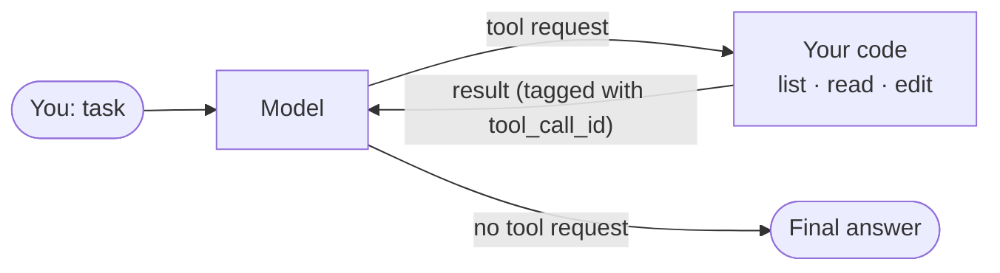

<div align="center">

# VAT001 · Every AI Agent Is the Same Loop

**A tiny coding agent in one Python file: one model, three tools, one loop.**

[](https://youtu.be/8mPFxocLvtU)
[](../README.md#episodes)
[](https://www.python.org/)
[](https://pypi.org/project/openai/3.35.1/)
[](#verified)
[](#offline-tests)
[](../LICENSE)

`agent-loop` · `tool-calling` · `function-calling` · `harness` · `python` · `no-framework`

</div>

---

> **▶ Watch the episode:** [https://youtu.be/8mPFxocLvtU](https://youtu.be/8mPFxocLvtU) · [Vey Arc on YouTube](https://www.youtube.com/channel/UCLV_kslwMQv05BqudyKRL5g)

## Contents

- [What you build](#what-you-build)
- [How it works](#how-it-works)
- [Requirements](#requirements)
- [Run it](#run-it)
- [Provider settings](#provider-settings)
- [Offline tests](#offline-tests)
- [Record your own runs](#record-your-own-runs)
- [Verified](#verified)
- [What's missing](#whats-missing)
- [Files](#files)

## What you build

A coding agent that lives in your terminal. It can:

| Tool | What it does | Safety |
|---|---|---|
| `list_files(path)` | List files and folders | Paths must stay inside the folder you started it in |
| `read_file(path)` | Read a text file | Same path check |
| `edit_file(path, old_text, new_text)` | Replace text that appears **exactly once** (empty `old_text` creates a file) | Asks `[y/N]` before every write |

The whole agent is [`agent.py`](agent.py): 134 lines, 99 of them code.

## How it works



1. Send the conversation and the three tool descriptions to the model.
2. If the reply asks for tools, **your code** runs each one and appends the result, tagged with the request it answers.
3. Repeat until the model replies without a tool request, or 20 rounds pass.

Errors (a bad path, an edit that doesn't match the file) and refusals (you answer `N`) go back to the model as plain text, so it can decide what to do next. There is no other retry or recovery logic.

## Requirements

- Python **3.10 or newer** (`openai` 3.x does not install on 3.9)
- An API key for any service that speaks the OpenAI **Chat Completions** format with tool calls, or a local Ollama server

## Run it

```bash
cd VAT001_agent-loop
python -m venv .venv
source .venv/bin/activate            # Windows: .venv\Scripts\Activate.ps1
pip install -r requirements.txt
```

Set the three variables for your provider (next section), then:

```bash
cd demo
python stats.py                      # average: 135.0  <- the bug
python ../agent.py "Find and fix the bug in stats.py"
python stats.py                      # average: 90.0 after you answer y
```

The agent only touches files inside the folder you run it from (`demo/` here) and asks before every edit.

## Provider settings

| Provider | `OPENAI_BASE_URL` | `OPENAI_API_KEY` | `AGENT_MODEL` |
|---|---|---|---|
| DeepSeek (default model name) | `https://api.deepseek.com` | your DeepSeek key | `deepseek-flash` |
| OpenAI | leave unset | your OpenAI key | a model that supports tool calls in **Chat Completions** |
| Ollama (local, free) | `http://localhost:11434/v1` | `ollama` (any text) | a model listed under *tools* at ollama.com/search?c=tools |

<details>
<summary><b>macOS / Linux</b></summary>

```bash
export OPENAI_BASE_URL=https://api.deepseek.com
export OPENAI_API_KEY=sk-...
export AGENT_MODEL=deepseek-flash
```
</details>

<details>
<summary><b>Windows PowerShell</b></summary>

```powershell
$env:OPENAI_BASE_URL = "https://api.deepseek.com"
$env:OPENAI_API_KEY  = "sk-..."
$env:AGENT_MODEL     = "deepseek-flash"
```
</details>

> [!NOTE]
> Some of OpenAI's newest models only support tool calls through the Responses API. Pick a model whose page lists tool calling in Chat Completions.

> [!WARNING]
> Small local models call tools much less reliably than large hosted ones. Expect more failed or looping runs with Ollama.

## Offline tests

No key and no network needed. A scripted fake model drives the real `agent.py`:

```bash
python tests/test_agent.py
```

| Test | Checks |
|---|---|
| `test_full_run_with_a_recoverable_bad_edit` | A paraphrased edit fails, the error goes back tagged with its `tool_call_id`, the retry succeeds |
| `test_user_refuses_the_edit` | Answering `N` leaves the file unchanged and sends the refusal text to the model |
| `test_paths_outside_the_project_are_refused` | `../`, absolute paths and sneaky `a/../../` paths are rejected |
| `test_bad_tool_arguments_become_an_error_message` | Wrong arguments or unknown tools don't crash the loop |
| `test_create_file_and_step_limit` | Empty `old_text` creates a file; the loop stops after 20 rounds |

## Record your own runs

[`record_run.py`](record_run.py) runs `agent.py` unchanged and saves a timestamped log of everything: printed lines, your `y/N` answers, each model call's duration and token usage, and the tool results the model received. Your API key is never written.

```bash
cd demo
python ../record_run.py "Find and fix the bug in stats.py"
```

Before each run it restores `stats.py` from a clean copy kept in `recordings/` (not in `demo/`, so the agent never sees it). Logs are saved as `recordings/run_<date>_<time>.json`.

## Verified

| Date | Python | openai | Provider / model | Result |
|---|---|---|---|---|
| 2026-10-19 | 3.13.16 (Windows 11) | 3.35.1 | DeepSeek · `deepseek-flash` | 6 real runs: same one-line fix every time; 5 accepted → `average: 90.0`, 1 refused → file unchanged |
| 2026-10-20 | 3.13 | stub (no network) | offline fake model | 5/5 tests pass |

The six video runs are in [`recordings/`](recordings/). Per run: 3 to 5 model calls, about 3,000 to 4,700 tokens, 9.6 to 15.3 seconds including the time to answer `y/N`. Six runs on one small file are a demo, not a reliability benchmark.

## What's missing

This is the core loop, on purpose. It has no shell commands, no test runner, no memory between sessions, and it reads whole files, which gets expensive on large ones. Later VAT episodes add some of these.

## Files

```
VAT001_agent-loop/
├── agent.py            # the whole agent
├── record_run.py       # logs a real run (used for the video)
├── requirements.txt    # openai==3.35.1
├── demo/
│   └── stats.py        # a small file with a bug
├── tests/
│   └── test_agent.py   # offline tests, fake model
└── recordings/         # logs of the six runs shown in the video
```

## License

[MIT](../LICENSE). Product names are trademarks of their owners and are used only to identify compatible services.
